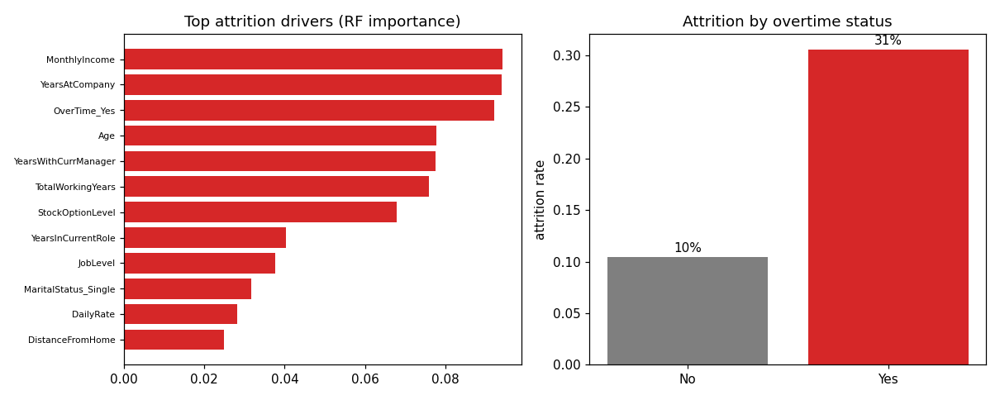

# Employee Turnover Analytics

Attrition risk on the IBM HR sample, with a model deliberately capped so the score cannot be an artifact.

**Built:** October 2026

## The question

Can a simple model separate leavers from stayers, and which factors carry the signal? The trap in this dataset is that 1,470 rows against roughly 100 dummy features is linearly separable, so an unconstrained model scores perfectly while learning nothing.

## Data

- **IBM HR Analytics Employee Attrition (WA_Fn-UseC_-HR-Employee-Attrition)** - 1,470 employees, 35 fields
- Source: IBM sample dataset, via the public mirror at TheAlgorithms/Jupyter (IBM synthetic sample data, public for analysis)
- Attrition rate 16.1 percent. EmployeeCount, Over18 and StandardHours are constant and dropped.

## Method

- Capacity limits: logistic at C=0.05, forest at max_depth=4 with min_samples_leaf=25
- Headline score is 5-fold stratified out-of-fold AUC, not a single hold-out
- Operating point chosen at 0.42 and reported as a flag rate, not as accuracy
- Driver ranking from random-forest importances

## Results

| Metric | Value |
|---|---|
| attrition_rate | 0.1612 |
| rf_cv_auc_mean | 0.7852 |
| rf_cv_auc_std | 0.0240 |
| lr_cv_auc_mean | 0.8256 |
| rf_holdout_auc | 0.7618 |
| lr_holdout_auc | 0.8080 |
| rf_pr_auc | 0.3952 |
| flag_rate_at_0_42 | 0.3859 |
| precision_at_thr | 0.3170 |
| recall_at_thr | 0.7630 |

### Highest-importance drivers

| feature | importance |
|---|---|
| MonthlyIncome | 0.0942 |
| YearsAtCompany | 0.094 |
| OverTime_Yes | 0.0923 |
| Age | 0.0778 |
| YearsWithCurrManager | 0.0776 |
| TotalWorkingYears | 0.0759 |
| StockOptionLevel | 0.068 |
| YearsInCurrentRole | 0.0404 |
| JobLevel | 0.0375 |
| MaritalStatus_Single | 0.0316 |
| DailyRate | 0.0282 |
| DistanceFromHome | 0.0249 |



*Driver ranking and the overtime effect*

## What the numbers mean

Honest out-of-fold AUC is 0.79 for the forest and 0.83 for the linear model. Unconstrained versions of the same models score 1.00, which is model capacity, not workforce insight; that is the actual lesson in this repo. Overtime carries the strongest visible signal, with low satisfaction and short tenure behind it.

## Limitations

1,470 rows cannot support a rich interaction model, so these numbers should not be compared to models on bigger HR data. Precision at the chosen threshold is 0.32, meaning a flagged employee is more likely to stay than leave; it is a screening tool, not a prediction about a person. Synthetic vendor data does not represent any real workforce.

## Run it

    pip install -r requirements.txt
    python src/main.py

```
python src/main.py            # requires the dataset in data/ (see data/README.md)
```

## License

MIT
